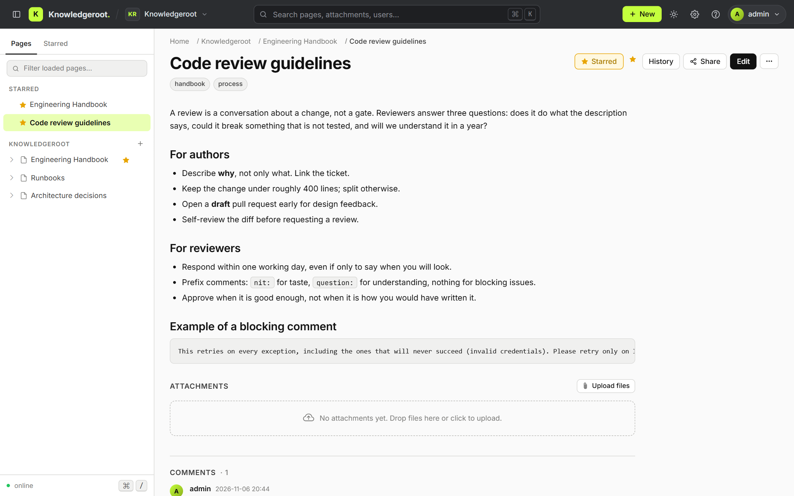
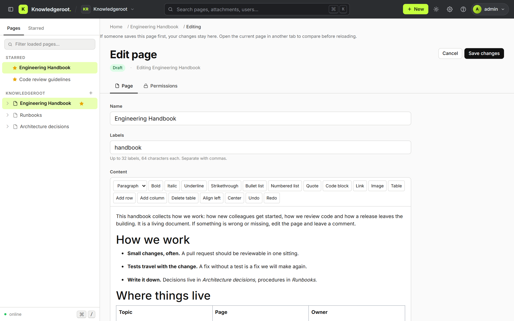
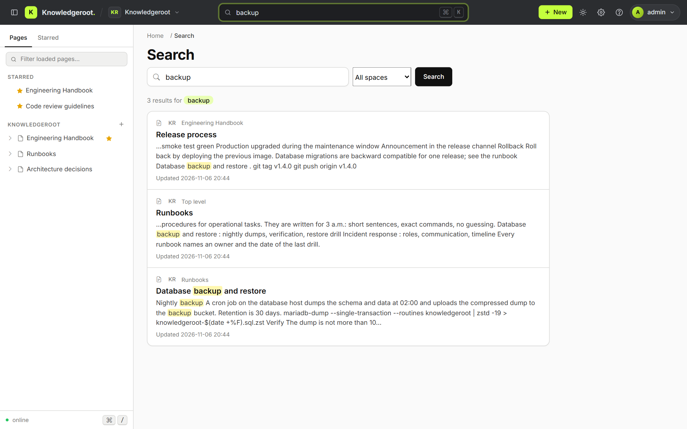
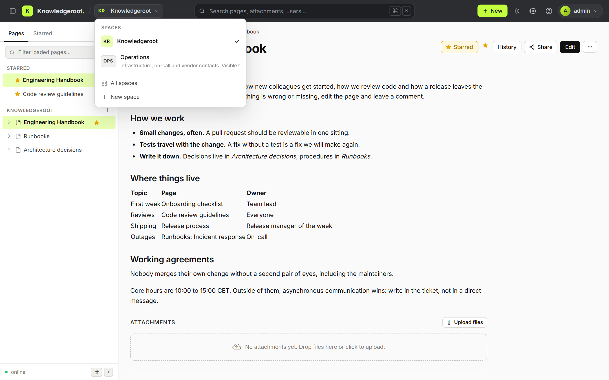
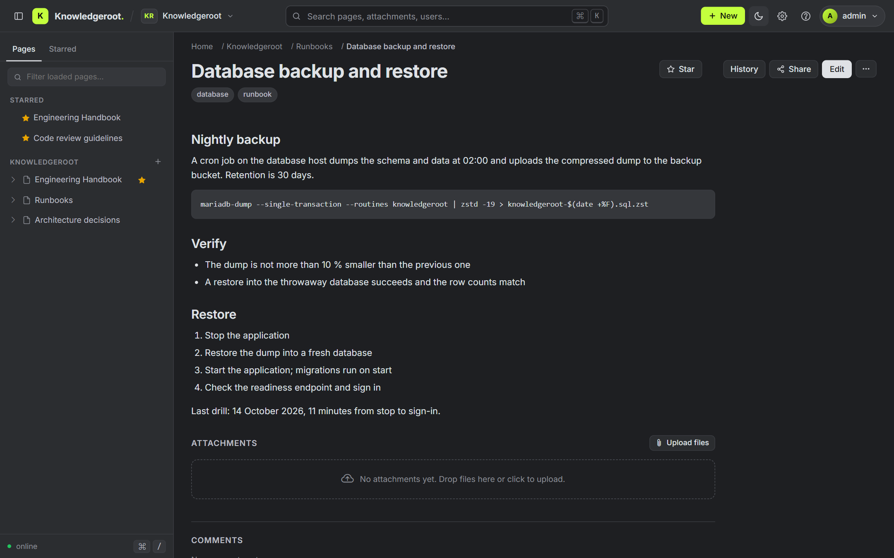
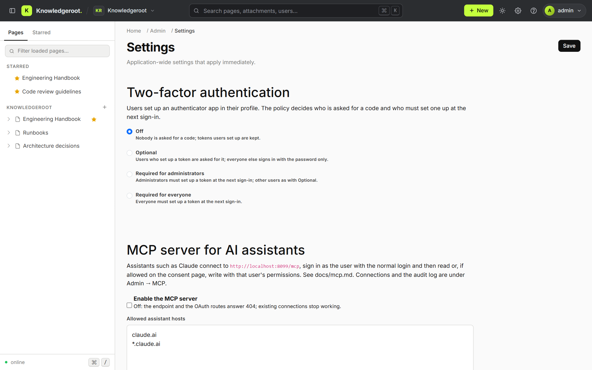

# Knowledgeroot

**A self-hosted knowledge base for teams.** Pages live in a tree inside spaces,
every change is kept, and access is controlled per space and per page. Written in
Java with Spring Boot and MariaDB, shipped as a Docker image, licensed under
BSD-2-Clause.

[](https://github.com/lordlamer/jknowledgeroot/releases)
[](https://hub.docker.com/r/lordlamer/knowledgeroot)
[](https://github.com/lordlamer/jknowledgeroot/actions/workflows/maven.yml)
[](LICENSE)

Website: [knowledgeroot.org](https://knowledgeroot.org) · Images: [Docker Hub](https://hub.docker.com/r/lordlamer/knowledgeroot) · Docs: [docs/](docs/)

| | |
|---|---|
|  |  |
|  |  |
|  |  |

## Features

- **Spaces and page trees.** Every page lives in a space with its own view, edit and
  admin grants. Move whole subtrees, even across spaces; links, comments, labels and
  attachments survive the move.
- **Permissions that are enforced once, on the server.** Grants for users, groups, guests
  or all signed-in users; new pages inherit from their parent, administrators switch a
  page to local grants. Public read access never implies editing. Search, the API and the
  MCP server all apply the same rules.
- **Rich-text editor** (Tiptap, MIT-licensed, no license key): headings, lists, tables,
  code blocks, quotes, links and images. Pasted HTML is sanitised in the browser and again
  on the server.
- **History you can use.** Every save keeps a version; compare any two versions side by
  side, restore an earlier one, and recover deleted pages as an administrator. Stale
  revisions are detected and your draft is preserved on a conflict.
- **Search with filters** across all spaces you may enter, or inside one space, by label,
  change date and last editor. Permissions are applied before pagination.
- **Attachments** on local disk or in any S3-compatible bucket, streamed with SHA-256
  hashing and size limits; comments, labels and favourites on every page.
- **Sign-in done properly.** PBKDF2 password hashing, login throttling per account and
  per source address, CSRF protection, sessions in the database, optional password
  recovery by email, and two-factor authentication (TOTP with recovery codes) with a
  policy from *off* to *required for everyone*.
- **AI assistants over MCP.** Claude and other MCP clients connect to `/mcp` with
  OAuth 2.1 using the user's own account. They see exactly what that user may see; writing
  is a separate consent. Administrators get an audit log of every call.
- **Client API and mobile app.** A JSON API under `/api/v1` with the same session and
  CSRF protection serves the Knowledgeroot Flutter app.
- **Six interface languages:** English, German, French, Spanish, Italian and Dutch, chosen
  per user; a light and a graphite dark theme.
- **Built to operate.** Liveness and readiness probes, administrator metrics, Liquibase
  migrations on start, a hardened container running as a non-root user, documented backup,
  restore and rollback procedures, and release artefacts with checksums.

## Versions

| Line | Version | Where | Contains |
|---|---|---|---|
| Stable | **1.1.0** | branch `release/1.1`, tag `v1.1.0` | Spaces, page tree, editor, history, page permissions, attachments, search, two-factor authentication, the MCP server, the client API, the graphite theme and six interface languages |
| Previous | **1.0.0** | branch `release/1.0`, tag `v1.0.0` | Without spaces, two-factor authentication, MCP server and client API; upgrading to 1.1 requires `KR_MASTER_KEY` |
| Development | `1.2.0-SNAPSHOT` (`latest`) | branch `master` | The next line; not for production |

Release tags publish both Docker images and a GitHub release with the verified JAR
and `SHA256SUMS`. See the [release guide](docs/release.md) for artefact identity and
the [release notes](https://github.com/lordlamer/jknowledgeroot/releases).

## Quick start with Docker Compose

You need Docker with the Compose plugin. The Compose file in `deploy/` starts
MariaDB and the application with separate migration and runtime database accounts,
a read-only container file system and a persistent volume for attachments.

```bash
git clone https://github.com/lordlamer/jknowledgeroot.git
```

```bash
cp jknowledgeroot/deploy/production.env.example ~/knowledgeroot.env
```

Edit `~/knowledgeroot.env` (keep it outside the repository and readable by you only):

- `KR_APP_IMAGE=lordlamer/knowledgeroot:v1.1.0` and
  `KR_DB_IMAGE=lordlamer/knowledgeroot:database-v1.1.0` (or the digests of a release)
- three random database passwords and a random `KR_MASTER_KEY` of at least 32 characters
- `KR_BOOTSTRAP_LOGIN` and `KR_BOOTSTRAP_PASSWORD` (16 to 128 characters) for the first
  administrator; there is no default account

```bash
docker compose -p knowledgeroot --env-file ~/knowledgeroot.env -f jknowledgeroot/deploy/compose.production.yaml up -d
```

Open <http://localhost:8081>, sign in with the bootstrap account, then remove the two
bootstrap variables from the env file. For anything beyond your own machine put a
TLS-terminating reverse proxy in front and read the
[production deployment guide](docs/production.md) (proxy trust, HTTPS cookies,
`KR_PUBLIC_URL`, mail) and [backup and recovery](docs/recovery.md).

Without Docker, the JAR from a [GitHub release](https://github.com/lordlamer/jknowledgeroot/releases)
runs with `java -jar knowledgeroot-<version>.jar` on JDK 25 against your own MariaDB;
the [installation guide](docs/installation.md) lists the environment variables.

## Connect an AI assistant

1. *Admin → Settings*: enable **MCP server for AI assistants**. The page shows the
   server URL, `https://<host>/mcp`.
2. In claude.ai or Claude Desktop add a custom connector with that URL; in Claude Code
   run `claude mcp add --transport http knowledgeroot https://<host>/mcp`.
3. Sign in to Knowledgeroot when the assistant asks, and decide on the consent page
   whether it may only read or also write.

The assistant can then list spaces, search, read pages, attachments and history and,
with write consent, create, edit, move and comment on pages. Every user sees and
disconnects their assistants in the profile; administrators see every call under
*Admin → MCP*. Details in the [MCP guide](docs/mcp.md).

## Documentation

| Topic | Guide |
|---|---|
| Product functions of 1.0 and 1.1 | [product-functions.md](docs/product-functions.md) |
| Installation, first administrator, upgrades | [installation.md](docs/installation.md) |
| Production deployment, proxy, HTTPS, mail | [production.md](docs/production.md) |
| Backup, restore, upgrade and rollback | [recovery.md](docs/recovery.md) |
| Spaces and page permissions | [access-control.md](docs/access-control.md) |
| Sign-in, sessions, throttling, two-factor | [authentication.md](docs/authentication.md), [account-recovery.md](docs/account-recovery.md) |
| MCP server for AI assistants | [mcp.md](docs/mcp.md) |
| Client API for apps | [client-api.md](docs/client-api.md) |
| Attachments and storage | [storage.md](docs/storage.md), [transactions.md](docs/transactions.md) |
| Search, input limits, error responses | [search-and-validation.md](docs/search-and-validation.md) |
| Page history and deleted pages | [page-history.md](docs/page-history.md) |
| Editor and frontend build | [editor.md](docs/editor.md) |
| Interface languages | [translations.md](docs/translations.md) |
| Monitoring, probes and metrics | [monitoring.md](docs/monitoring.md) |
| Load testing | [load-testing.md](docs/load-testing.md) |
| Releases, artefacts and checksums | [release.md](docs/release.md) |
| Dependency and container audits | [dependencies.md](docs/dependencies.md), [image-security.md](docs/image-security.md) |
| Roadmap and acceptance record | [roadmap.md](docs/roadmap.md), [operational-acceptance.md](docs/operational-acceptance.md) |
| Announcing releases | [promotion.md](docs/promotion.md) |

Most guides are written in German; the product functions and the MCP guide are the
best starting points.

## Build and tests

Install JDK 25 and set `JAVA_HOME` to its installation directory. Start a Docker
engine for the isolated MariaDB and MinIO tests. The Maven Wrapper downloads the
pinned Maven version on its first invocation; a separate Maven installation is not
required. Maven also installs the pinned Node/npm toolchain and builds the editor
from `frontend/package-lock.json`. The browser test downloads Chromium on its first
run; Linux needs the system libraries described in the [editor and build guide](docs/editor.md).

On Linux or macOS:

```sh
sh ./mvnw -B --no-transfer-progress verify
```

On Windows (PowerShell):

```powershell
.\mvnw.cmd -B --no-transfer-progress verify
```

The build compiles the application, runs the tests and creates the executable JAR in
`target/`. Integration tests use isolated databases, real login and CSRF and JDBC
sessions; installation tests run against a real MariaDB in Testcontainers. During
`verify`, Failsafe starts the packaged JAR against disposable MariaDB/RustFS containers
and checks HTTP login, administrator access, WebJars, session persistence across a
restart and logout. Chromium checks editor creation and saving, repeated htmx navigation,
rich-text preservation, malicious paste handling and a real file upload and download.
A second JAR start uses local storage with an invalid MinIO URL and checks an upload at
the size limit, its download and HTTP 413 above the limit.

The JavaScript of the build, release and deployment scripts and of the editor is linted
with the repository's `eslint.config.mjs` (`npx eslint .`); Codacy keeps its own rule
selection for the application code and leaves those scripts out (see `.codacy.yml`).

Spring Boot 4.1 manages the framework dependencies. See the
[dependency and security audit guide](docs/dependencies.md) for migration details,
the Tomcat security override and repeatable Maven/npm scanning.

## Local development

The project reads credentials and runtime settings from environment variables.

1. Copy `.env.example` to `.env` and set your own values.
2. Start the development dependencies (MariaDB and an S3-compatible store):
   `docker compose --env-file .env up -d`
3. Start the application: `sh ./mvnw spring-boot:run` (Windows: `.\mvnw.cmd spring-boot:run`)

Fresh databases require `KR_BOOTSTRAP_LOGIN` and `KR_BOOTSTRAP_PASSWORD` on the first
start. Demo data is loaded only with the explicit `development` profile; see the
[installation guide](docs/installation.md). The Docker image runs as UID 10001;
production Compose is separate from the development services.

The screenshots above come from a disposable instance seeded with
`scripts/screenshots/seed.sh` and taken with `scripts/screenshots/shoot.mjs`.

## History and license

Knowledgeroot is the Java rewrite of the PHP knowledge base of the same name by the
same author; the rewrite started in 2017. The project is licensed under the
[BSD-2-Clause license](LICENSE). Contributions, bug reports and questions are welcome
in the [issue tracker](https://github.com/lordlamer/jknowledgeroot/issues).
